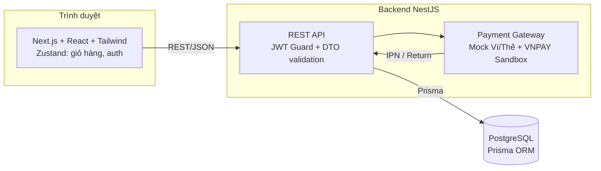
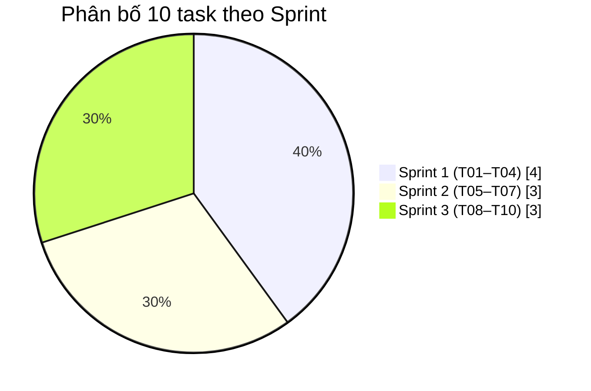
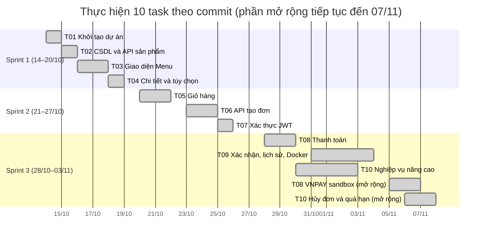
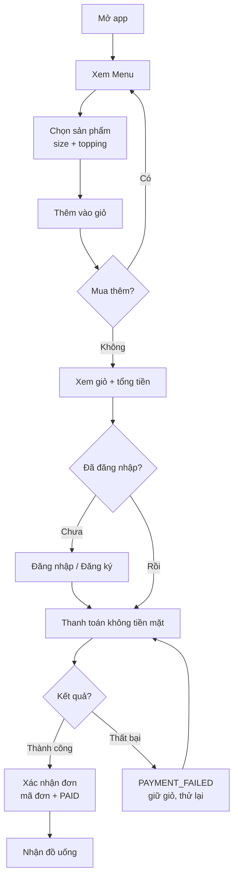
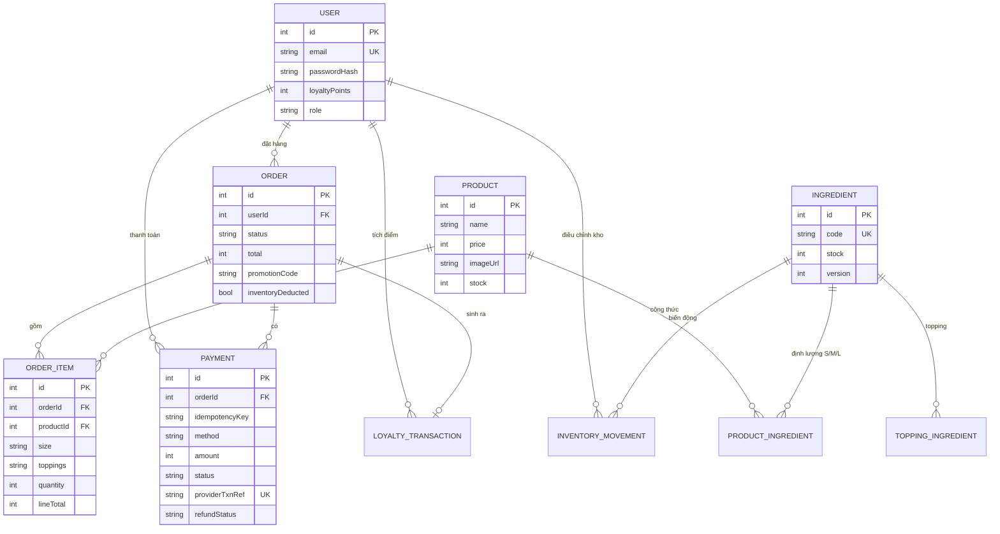
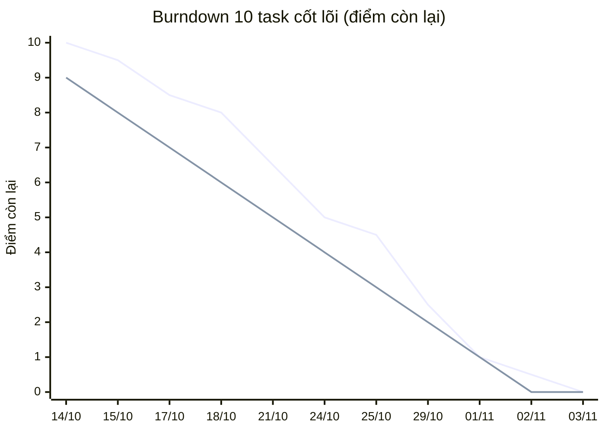
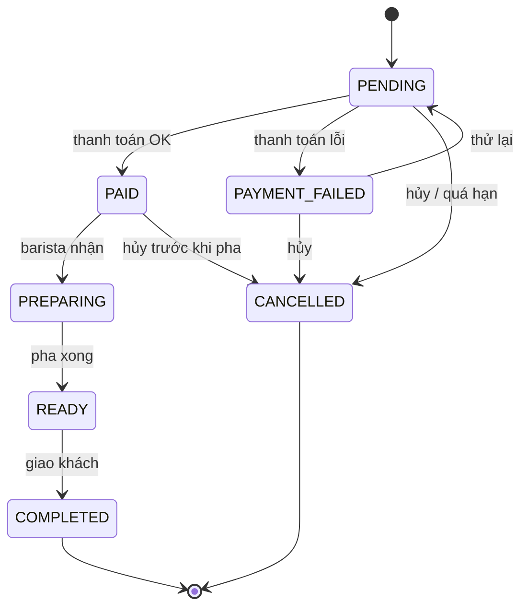
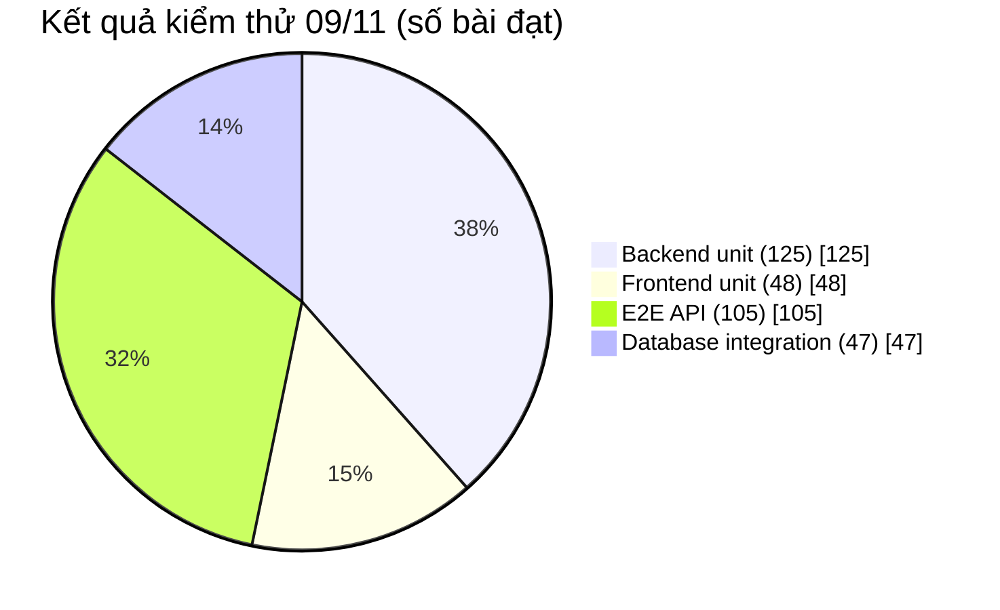

# BrewLite — Báo cáo Assignment 1

**Trường Đại học Sài Gòn · Khoa Công nghệ Thông tin**
**Môn học:** Công nghệ Phần mềm · Học kỳ I — Năm học 2026–2027
**Đề tài:** BrewLite — Hệ thống đặt và thanh toán đồ uống tại quầy
**Giảng viên hướng dẫn:** ThS. Từ Lãng Phiêu · **Nhóm:** 05

| STT | Họ và tên | Vai trò | MSSV |
|---|---|---|---|
| 1 | Nguyễn Minh Hiển | Trưởng nhóm / Scrum Master | 3124410088 |
| 2 | Trần Đăng Khoa | Thành viên | (bổ sung) |
| 3 | Nguyễn Chí Thành | Thành viên | (bổ sung) |
| 4 | Phạm Minh Thiện | Thành viên | (bổ sung) |
| 5 | Trần Kim Xuyến | Thành viên | (bổ sung) |
| 6 | Trần Minh Hiệp | Thành viên | (bổ sung) |

> Báo cáo viết dạng Markdown, mở trực tiếp trên GitHub; các biểu đồ dùng Mermaid (GitHub render sẵn). Số liệu kiểm thử và nhật ký task được đối chiếu với lịch sử commit và mã nguồn tại thời điểm 09/11/2026.

---

## Chương 1: Giới thiệu tổng quan và tổ chức dự án

BrewLite là ứng dụng web hỗ trợ đặt và thanh toán đồ uống tại quầy. Khách hàng xem thực đơn, chọn kích cỡ và topping, quản lý giỏ, đăng nhập rồi thanh toán không dùng tiền mặt. Báo cáo trình bày phạm vi sản phẩm, cách tổ chức nhóm theo Scrum, nhật ký 10 task, kết quả kiểm thử và nội dung bàn giao.

### 1.1 Phạm vi dự án và công nghệ sử dụng

**Phạm vi nghiệp vụ cốt lõi (MVP):** luồng khép kín dành cho khách hàng: Tra cứu thực đơn → Xem chi tiết & tùy chỉnh → Quản lý giỏ hàng → Đăng ký/Đăng nhập → Checkout & Thanh toán (mô phỏng Ví/Thẻ, tích hợp VNPAY sandbox) → Xác nhận đơn & Lịch sử mua hàng. Phần mở rộng: mô-đun Nhân viên quầy (tiếp nhận đơn, cập nhật trạng thái pha chế, quản lý kho nguyên liệu).

**Công nghệ lựa chọn (đúng yêu cầu đề bài Next.js + NestJS):**

| Thành phần | Công nghệ |
|---|---|
| Frontend | Next.js (React, TypeScript), Tailwind CSS, Zustand (giỏ hàng, phiên xác thực) |
| Backend | NestJS (Node.js, TypeScript), Prisma ORM, PostgreSQL |
| Bảo mật | Bcrypt (băm mật khẩu), JWT Guard, Class-Validator/DTO |
| Thanh toán | Mock Ví/Thẻ + VNPAY sandbox (IPN/Return, chữ ký HMAC) |
| Đóng gói | Docker & Docker Compose (Web, API, PostgreSQL), Git, README bàn giao |

**Kiến trúc hệ thống:**



### 1.2 Phân công nhiệm vụ

| Thành viên | Phạm vi phụ trách |
|---|---|
| Nguyễn Minh Hiển | T01, T06, T10B; khởi tạo dự án, API tạo đơn, idempotency thanh toán, trừ kho, giao diện Nhân viên; tích hợp chung |
| Trần Đăng Khoa | T07, T10A; xác thực JWT/Bcrypt, máy trạng thái đơn, khuyến mãi, điểm thưởng |
| Nguyễn Chí Thành | T02, T08 (backend); API danh mục/chi tiết sản phẩm, API thanh toán (mock + VNPAY) |
| Phạm Minh Thiện | T05, T08 (frontend); giỏ hàng Zustand, màn hình Checkout/Thanh toán |
| Trần Kim Xuyến | T03, T09 (frontend); trang Menu, màn hình Xác nhận & Lịch sử đơn |
| Trần Minh Hiệp | T04, T09 (DevOps); chi tiết sản phẩm & topping, Docker Compose, tài liệu bàn giao |

### 1.3 Tổ chức công việc theo Scrum

Nhóm theo dõi công việc bằng GitHub Issues và Project, phát triển trên nhánh và gửi review trước khi tích hợp vào `main`. **Product Owner:** Giảng viên phụ trách môn học · **Scrum Master:** Nguyễn Minh Hiển. Kế hoạch chia thành ba Sprint theo nhóm chức năng trong đề.

**Phân bố 10 task theo Sprint:**



**Kế hoạch và thực hiện (theo ngày commit thực tế):**



| Sprint | Thời gian trên Project | Phạm vi |
|---|---|---|
| Sprint 1 | 14–20/10/2026 | T01–T04: nền tảng và Menu |
| Sprint 2 | 21–27/10/2026 | T05–T07: giỏ hàng, tạo đơn, xác thực |
| Sprint 3 | 28/10–03/11/2026 | T08–T10: thanh toán, bàn giao, nghiệp vụ nâng cao |

### 1.4 Mục tiêu của đề tài

BrewLite giúp khách chọn đồ uống và thanh toán không dùng tiền mặt ngay trên trình duyệt, giảm thao tác đặt món thủ công tại quầy. Mục tiêu Assignment 1 là xây dựng phiên bản chạy được từ đầu đến cuối, thay vì các màn hình rời rạc. Về kỹ thuật, nhóm dùng Next.js và NestJS theo yêu cầu; tổ chức dữ liệu, xác thực và xử lý đơn hàng ở máy chủ. Về làm việc nhóm, các thành viên chia nhiệm vụ, lưu lịch sử phát triển và kiểm tra phần việc trước khi tích hợp.

### 1.5 Người dùng và phạm vi sử dụng

Khách hàng xem Menu, chọn kích cỡ/topping, quản lý giỏ, đăng nhập, thanh toán và xem lại đơn. Nhân viên quầy dùng khu vực riêng để theo dõi đơn và nguyên liệu (phần mở rộng hỗ trợ vận hành). Nhóm phát triển chịu trách nhiệm xây dựng và bàn giao bản chạy được; giảng viên đối chiếu sản phẩm, quy trình và minh chứng với tiêu chí đề bài. Thanh toán Ví/Thẻ trong A1 là mô phỏng; VNPAY dùng môi trường sandbox, không thực hiện giao dịch tiền thật.

### 1.6 Yêu cầu và luồng xử lý chính

Danh sách đồ uống có tên, ảnh, giá. Trang chi tiết cho chọn kích cỡ/topping và cập nhật giá. Giỏ hàng hỗ trợ thêm/sửa/xóa và tính tổng; có thông báo trạng thái tải/rỗng/lỗi. Khách cần đăng nhập trước khi tạo đơn; máy chủ kiểm tra dữ liệu, tính lại số tiền và lưu đơn chờ thanh toán. Thanh toán thành công → đơn PAID, xóa giỏ, hiển thị mã đơn; thất bại → ghi nhận lỗi và giữ giỏ để thử lại. Lịch sử đơn chỉ trả dữ liệu của tài khoản đang đăng nhập. Giá, khuyến mãi, điểm và trạng thái đơn xác định tại máy chủ.

**Luồng nghiệp vụ mua hàng (happy path + nhánh lỗi):**



Yêu cầu chất lượng của đề: phản hồi API dưới 500 ms với dữ liệu mẫu, mật khẩu băm, JWT và kiểm tra đầu vào. Kết quả đạt gắn với môi trường và phạm vi đã kiểm thử, không suy rộng thành bảo đảm cho mọi mức tải.

### 1.7 Tổ chức dữ liệu

Giao diện Next.js gửi yêu cầu đến REST API NestJS; backend dùng Prisma đọc/ghi PostgreSQL. Nhóm dữ liệu chính: sản phẩm, tài khoản, đơn, chi tiết đơn, thanh toán; phần mở rộng: nguyên liệu, công thức, khuyến mãi, lịch sử điểm, biến động kho. Đơn hàng lưu lựa chọn và số tiền tại thời điểm đặt; kho tính theo nguyên liệu cần cho món, kích cỡ và số phần topping.

**Sơ đồ quan hệ dữ liệu (ERD rút gọn từ Prisma schema):**



### 1.8 Quản lý tiến độ và biểu đồ Burndown

Các Issue là danh sách công việc; Sprint thể hiện nhóm nhiệm vụ theo giai đoạn; bản tích hợp chạy được là kết quả tăng dần. Thành viên trao đổi phạm vi trước khi sửa, phát triển trên nhánh rồi gửi review. Theo Scrum: lập kế hoạch đầu Sprint, trao đổi hằng ngày, Review trình diễn và Retrospective rút kinh nghiệm.

**Burndown 10 task cốt lõi** (mỗi task 1 điểm theo đề; đường thực tế suy ra từ số task đã merge về `main`, không dùng số commit):



> Đường phía trên (giảm đều) là **Lý tưởng (Ideal)**; đường phía dưới (bậc thang) là **Thực tế (Actual)** — nhóm hoàn thành 10 task cốt lõi ngày 02/11, sớm hơn hạn Sprint 3 (03/11). Phần mở rộng (VNPAY sandbox, hủy đơn/quá hạn) tiếp tục đến 07/11 nên không phản ánh trong đường cốt lõi này. Biên bản họp và dữ liệu điểm chi tiết từng ngày được nhóm bổ sung từ hoạt động thực tế.

---

## Chương 2: Nhật ký tiến độ và chi tiết thực hiện các task

Nhật ký ghi theo ngày commit thực tế trên kho mã nguồn; thời gian tính theo giờ Việt Nam. Mỗi task ghi phân công, quá trình bổ sung/chỉnh sửa và bàn giao.

### 2.1. Task 1: Khởi tạo dự án và Kiến trúc nền tảng (T01)

| STT | Thời gian | Loại | Nội dung |
|---|---|---|---|
| 1 | 14/10/2026 | Phân công | Hiển: khởi tạo dự án Next.js/NestJS, Git và môi trường chạy. |
| 2 | 14/10/2026 | Bổ sung | Hiển khởi tạo kho mã nguồn, hai ứng dụng frontend (Next.js) và backend (NestJS); thiết lập tệp môi trường mẫu và hướng dẫn chạy. |
| 3 | 14/10/2026 | Bàn giao | Hiển bàn giao cấu trúc dự án, cấu hình chạy và hướng dẫn khởi động để các thành viên phát triển tiếp. |

### 2.2. Task 2: Thiết kế Cơ sở dữ liệu và API Sản phẩm (T02)

| STT | Thời gian | Loại | Nội dung |
|---|---|---|---|
| 1 | 14/10/2026 | Phân công | Thành: cơ sở dữ liệu Prisma/PostgreSQL và API sản phẩm. |
| 2 | 15/10/2026 | Bổ sung | Thành tạo schema sản phẩm bằng Prisma, dữ liệu mẫu và API lấy danh sách, xem chi tiết đồ uống. |
| 3 | 15/10/2026 | Bàn giao | Thành bàn giao API sản phẩm kèm hướng dẫn sử dụng trong README để nhóm kết nối với giao diện Menu. |

### 2.3. Task 3: Phát triển Giao diện Thực đơn (T03)

| STT | Thời gian | Loại | Nội dung |
|---|---|---|---|
| 1 | 14/10/2026 | Phân công | Xuyến: Menu, dữ liệu API và ảnh sản phẩm. |
| 2 | 16/10/2026 | Bổ sung | Xuyến xây dựng trang Menu hiển thị tên, ảnh, giá đồ uống từ API; xử lý trạng thái tải, danh sách rỗng và lỗi kết nối. |
| 3 | 17/10/2026 | Chỉnh sửa | Xuyến thay ảnh sản phẩm và cập nhật README cho Task 3. |
| 4 | 17/10/2026 | Bàn giao | Xuyến bàn giao giao diện Menu hoàn chỉnh sau chỉnh sửa, đã kết nối dữ liệu sản phẩm. |

### 2.4. Task 4: Màn hình Chi tiết Sản phẩm & Tùy chọn (T04)

| STT | Thời gian | Loại | Nội dung |
|---|---|---|---|
| 1 | 14/10/2026 | Phân công | Hiệp: trang chi tiết, kích cỡ và topping. |
| 2 | 18/10/2026 | Bổ sung | Hiệp xây dựng trang chi tiết đồ uống: chọn kích cỡ S/M/L, chọn topping và cập nhật giá theo lựa chọn. |
| 3 | 18/10/2026 | Bàn giao | Hiệp bàn giao trang chi tiết cùng chức năng tính giá để kết nối với giỏ hàng. |

### 2.5. Task 5: Quản lý Giỏ hàng linh hoạt (T05)

| STT | Thời gian | Loại | Nội dung |
|---|---|---|---|
| 1 | 14/10/2026 | Phân công | Thiện: giỏ hàng, số lượng và tổng tiền. |
| 2 | 20/10/2026 | Bổ sung | Thiện xây dựng giỏ hàng bằng Zustand: thêm món, tăng giảm số lượng, xóa món, hiển thị số lượng trên biểu tượng giỏ và tính tổng tiền. |
| 3 | 21/10/2026 | Chỉnh sửa | Thiện sửa bố cục theo thiết kế đã duyệt, Việt hóa nhãn, điều hướng về Menu sau khi thêm món; bổ sung tài liệu T04–T05. |
| 4 | 21/10/2026 | Bàn giao | Thiện bàn giao giỏ hàng đã chỉnh sửa để phát triển bước thanh toán. |

### 2.6. Task 6: API Tạo đơn hàng và Tính toán Giá (T06)

| STT | Thời gian | Loại | Nội dung |
|---|---|---|---|
| 1 | 14/10/2026 | Phân công | Hiển: API tạo đơn, kiểm tra dữ liệu và tính giá. |
| 2 | 23/10/2026 | Bổ sung | Hiển xây dựng API tạo đơn: kiểm tra món, kích cỡ, topping, số lượng; tính lại giá tại máy chủ rồi lưu đơn chờ thanh toán; cập nhật dependency có lỗ hổng bảo mật. |
| 3 | 24/10/2026 | Bàn giao | Hiển bổ sung kiểm thử cục bộ, cấu trúc dự án và hướng dẫn chạy/kiểm thử API tạo đơn; bàn giao để nhóm kết nối với đăng nhập, giỏ hàng và thanh toán. |

### 2.7. Task 7: Mô-đun Xác thực Người dùng & Bảo mật (T07)

| STT | Thời gian | Loại | Nội dung |
|---|---|---|---|
| 1 | 14/10/2026 | Phân công | Khoa: đăng ký/đăng nhập, JWT và thông báo xác thực. |
| 2 | 25/10/2026 | Bổ sung | Khoa xây dựng backend đăng ký/đăng nhập với JWT, mật khẩu băm Bcrypt, guard bảo vệ API và gắn đơn hàng với tài khoản; frontend gồm màn hình đăng nhập/đăng ký và auth store. |
| 3 | 25/10/2026 | Bàn giao | Khoa xử lý góp ý review, đồng bộ nút đăng nhập ở giỏ hàng và bổ sung kiểm thử đăng xuất/chuyển tài khoản; bàn giao mô-đun xác thực. |
| 4 | 30/10/2026 | Kiểm tra | Hiển kiểm tra lại đăng ký, đăng nhập và quyền truy cập API; bổ sung kết quả kiểm thử vào tài liệu dự án. |
| 5 | 02/11/2026 | Chỉnh sửa | Khoa sửa thông báo validation đăng ký, phân loại lỗi đăng nhập theo từng ô (email/mật khẩu), phân biệt sai thông tin với mất kết nối. |
| 6 | 02/11/2026 | Bàn giao | Khoa bàn giao bản sửa thông báo lỗi xác thực kèm kiểm thử; nhóm tích hợp vào bản hoàn thiện. |

### 2.8. Task 8: Mô phỏng Thanh toán Trực tuyến (T08)

| STT | Thời gian | Loại | Nội dung |
|---|---|---|---|
| 1 | 14/10/2026 | Phân công | Thành phụ trách chức năng thanh toán. |
| 2 | 25/10/2026 | Bổ sung phân công | Thiện: giao diện checkout và thử lại thanh toán; Thành: API thanh toán. |
| 3 | 28/10/2026 | Bổ sung | Thành xây dựng API thanh toán ví/thẻ mô phỏng, xử lý thành công/thất bại/thử lại kèm kiểm thử và tài liệu bàn giao. Thiện xây dựng giao diện checkout. |
| 4 | 29/10/2026 | Chỉnh sửa | Thiện sửa việc lưu đơn chờ theo từng tài khoản đăng nhập và xử lý góp ý review giao diện checkout; Thành tổng hợp giao diện với API thành luồng thanh toán hoàn chỉnh. |
| 5 | 01/11/2026 | Chỉnh sửa | Hiển bổ sung số tiền phải trả ngay trên nút thanh toán để khách kiểm tra trước khi xác nhận. |
| 6 | 05/11/2026 | Bổ sung | Thành tích hợp cổng VNPAY sandbox phía backend: tạo URL thanh toán, xác thực chữ ký, xử lý IPN/Return. |
| 7 | 06/11/2026 | Bổ sung | Thiện xây dựng luồng checkout VNPAY phía frontend (mở tab thanh toán, theo dõi trạng thái, thử lại). Hiển bổ sung theo dõi trạng thái giao dịch, thử lại trên cùng đơn và ghi nhận callback thất bại cho đơn đã hủy. Thành ghi nhận kết quả xác minh sandbox và tài liệu bàn giao. |
| 8 | 09/11/2026 | Chỉnh sửa | Nhóm sửa cơ chế thử lại VNPAY: mỗi lần thử lại tạo giao dịch sandbox mới (txnRef mới) trên cùng đơn để tránh lỗi khóa giao dịch; IPN chỉ chốt đơn một lần. Trang chờ kết quả bổ sung nút xem lịch sử đơn hàng; chuẩn hóa bố cục nút thao tác trang xác nhận. |

### 2.9. Task 9: Màn hình Xác nhận, Lịch sử & Đóng gói Docker (T09)

| STT | Thời gian | Loại | Nội dung |
|---|---|---|---|
| 1 | 14/10/2026 | Phân công | Hiệp và Xuyến. |
| 2 | 28/10/2026 | Bổ sung phân công | Xuyến: xác nhận và lịch sử; Hiệp: Docker và hướng dẫn chạy. |
| 3 | 31/10/2026 | Bàn giao | Xuyến xây dựng và bàn giao trang xác nhận đơn, danh sách lịch sử và chi tiết đơn; hiển thị mã đơn, trạng thái và số tiền. |
| 4 | 31/10/2026 | Bổ sung | Hiệp bổ sung bộ chạy Docker Compose (web, API, PostgreSQL) cùng hướng dẫn cài đặt, nạp dữ liệu mẫu; sửa lỗi encoding/line-ending của mã nguồn khi đóng gói. |
| 5 | 01/11/2026 | Chỉnh sửa | Hiệp sửa việc giữ thông tin xác nhận sau thanh toán và lỗi compile Tailwind ở bản production; bàn giao bản Docker và hướng dẫn đã chỉnh sửa. |
| 6 | 03/11/2026 | Chỉnh sửa | Hiển bổ sung kiểm tra giới hạn ID trước khi truy vấn database, cho phép tải package qua mạng host khi build và chuẩn hóa tài liệu bàn giao đã xác minh. |

### 2.10. Task 10: Xử lý Nghiệp vụ Backend Nâng cao (T10)

| STT | Thời gian | Loại | Nội dung |
|---|---|---|---|
| 1 | 14/10/2026 | Phân công | Khoa và Hiển. |
| 2 | 28/10/2026 | Bổ sung phân công | Khoa: T10A trạng thái đơn, khuyến mãi, điểm thưởng; Hiển: T10B chống thanh toán lặp, tồn kho và nhân viên. |
| 3 | 30/10/2026 | Bổ sung | Khoa xây dựng schema và logic máy trạng thái đơn hàng, mã giảm giá, điểm thưởng tích lũy; kèm tài liệu giải thích quy tắc. |
| 4 | 31/10/2026 | Bàn giao | Khoa bổ sung kiểm thử trạng thái và hành vi database, bàn giao T10A. Hiển xây dựng và bàn giao T10B: chống thanh toán lặp bằng idempotency key, trừ kho trong giao dịch với khóa chống tranh chấp, kiểm soát nhiều đơn cùng mua để tránh âm kho. |
| 5 | 01/11/2026 | Bổ sung | Hiển bổ sung trang quản lý quầy: xem nguyên liệu, điều chỉnh kho có lý do, theo dõi đơn và điểm; phân quyền nhân viên với khách hàng. Cập nhật kết quả kiểm tra tích hợp và hướng dẫn bàn giao. |
| 6 | 02/11/2026 | Chỉnh sửa | Hiển sửa kiểm tra đủ nguyên liệu theo công thức, kích cỡ và số phần topping trước khi thêm vào giỏ; khôi phục hủy đơn đã thanh toán trước khi pha (hoàn kho, thu hồi điểm đúng một lần); cải thiện hiển thị tồn kho và chỉnh giỏ hàng. Chuẩn hóa README T01–T10. |
| 7 | 06/11/2026 | Bổ sung | Hiển bổ sung chức năng hủy đơn cho khách hàng và nhân viên: khách được hủy khi đơn chưa pha chế; đơn đã thanh toán được hoàn kho, thu hồi điểm và đưa vào hàng chờ hoàn tiền. |
| 8 | 07/11/2026 | Bàn giao | Hiển bổ sung job tự hủy đơn quá hạn thanh toán (15 phút, quét mỗi 30 giây) và theo dõi hoàn tiền VNPAY; bàn giao bản tổng hợp T10 cùng kiểm thử. |

**Máy trạng thái đơn hàng (T10A — đối chiếu `order-state.service.ts`):** mỗi chuyển tiếp không hợp lệ bị `assertTransition` chặn (ném lỗi 409). `COMPLETED` và `CANCELLED` là trạng thái kết thúc.



### 2.11 Tổng hợp kết quả phát triển

Nhóm đã tích hợp T01–T10 thành luồng mua hàng khép kín: Menu → chi tiết/tùy chỉnh → giỏ hàng → đăng nhập → tạo đơn → thanh toán (mock Ví/Thẻ và VNPAY sandbox) → xác nhận → lịch sử đơn. Phần nâng cao gồm máy trạng thái đơn, chống thanh toán lặp, kiểm soát kho khi nhiều yêu cầu đồng thời (khóa giao dịch + optimistic locking), mã giảm giá, điểm thưởng, hủy đơn có hoàn kho/thu hồi điểm và tự hủy đơn quá hạn. Trang nhân viên tách riêng khỏi chức năng mua hàng. Toàn bộ nhật ký đối chiếu theo lịch sử commit của kho mã nguồn; kết quả kiểm thử trình bày ở Chương 3.

---

## Chương 3: Kiểm thử phần mềm và hướng dẫn bàn giao

Nhóm dùng kiểm thử đơn vị (hàm/trạng thái), kiểm thử API (dữ liệu/quyền), kiểm thử PostgreSQL (giao dịch/đồng thời) và thao tác trình duyệt để đối chiếu trải nghiệm. Lint, typecheck và build kiểm tra tính hợp lệ mã nguồn và khả năng tạo bản chạy.

**Kết quả kiểm thử xác minh ngày 09/11/2026** (DB integration chạy trong container `api` với database riêng `brewlite_test`):

| Bộ kiểm thử | Kết quả | Ghi chú |
|---|---|---|
| Backend unit | 125/125 (22 file) | Vitest |
| Frontend unit | 48/48 (10 file) | Vitest |
| Backend E2E (API) | 105/106 | 1 bài PostgreSQL integration bỏ qua khi chạy trên host (cần `TEST_DATABASE_URL`) |
| Database integration | 47/47 (4 file) | chạy trong container, DB `brewlite_test` |
| **Tổng** | **325 bài đạt** | lint + typecheck cả hai ứng dụng đạt |

**Phân bố kết quả kiểm thử:**



### 3.1 Phân tích kết quả kiểm thử

Các con số thuộc từng bản mã nguồn và lần chạy đã ghi nhận; không cộng trùng các lượt kiểm tra độc lập. Bộ kiểm thử dữ liệu chứng minh: (a) chặn chuyển trạng thái sai; (b) gửi hai lần cùng Idempotency-Key chỉ tạo một thanh toán; (c) đặt hàng đồng thời không vượt tồn kho; cùng các trường hợp lỗi giữa giao dịch, hủy đơn đồng thời và hoàn kho/thu hồi điểm đúng một lần. Kết quả chứng minh các trường hợp đã xây dựng, không có nghĩa mọi tình huống vận hành đều đã được kiểm tra.

Minh chứng T10B dùng trình duyệt do Playwright điều khiển, kết nối API và PostgreSQL thử riêng: với 70 g thạch đủ hai phần, giỏ chặn tăng quá hai ly; đơn hai ly 72.000đ thanh toán thành công được cộng 7 điểm; kho giảm theo công thức; hủy trước khi pha hoàn nguyên liệu về mức ban đầu và điểm trở về 0.

**Hiệu năng API** (đo ngày 02/11 trên bản `005d1ef`): 10 API × 30 mẫu = 300/300 dưới 500 ms; mẫu lớn nhất 102,14 ms. Phép đo chạy tuần tự trên máy cục bộ sau khởi động nóng với dữ liệu thử, chưa đại diện cho tải cao hoặc đường truyền Internet.

### 3.2 Hướng dẫn chạy và kiểm tra hệ thống

Máy chạy cần Git và Docker Desktop. Lấy mã nguồn từ kho Git của nhóm, mở terminal tại thư mục gốc chứa `docker-compose.yml`, sao chép `.env.example` thành `.env` và điền cấu hình theo README (gồm khóa JWT riêng cho môi trường chạy). Khởi động Docker Desktop, đợi Engine running rồi thực hiện:

```bash
docker compose up --build -d
docker compose ps
```

Kiểm tra PostgreSQL và API ở trạng thái `healthy`, giao diện đã chạy. Lần đầu nạp dữ liệu mẫu: `docker compose exec api npm run prisma:seed`. Khách mở `http://localhost:3000`; nhân viên mở `http://localhost:3000/staff` bằng tài khoản được cấp quyền. Dữ liệu lưu trong volume PostgreSQL.

Những lần sau dùng `docker compose up -d`; sau khi đổi mã nguồn cần chạy lại lệnh build. Dừng bằng `docker compose down` (tránh `-v` nếu cần giữ dữ liệu). Khi có lỗi, kiểm tra trạng thái dịch vụ và log API, đối chiếu URL API, cổng và cấu hình môi trường trong README.

Chạy kiểm thử tự động: cài thư viện từng ứng dụng rồi `npm run lint`, `npm test`, `npm run build`. Với E2E và bài PostgreSQL, dùng cơ sở dữ liệu thử riêng, cấu hình `TEST_DATABASE_URL` (tên kết thúc bằng `_test`), chạy generate/migration/seed trước rồi `npm run test:e2e` và `npm run test:database` tại backend (chạy trong container `api` để tránh xung đột cổng 5432 trên host). Không dùng dữ liệu đang trình diễn cho các bài test có ghi/xóa.

### 3.3 Tổng kết quá trình thực hiện

Nhóm đã có bản chạy tích hợp và kết quả kiểm thử cho các chức năng A1. Khó khăn đã ghi nhận: giao diện production, lưu xác nhận sau thanh toán, thống nhất quy tắc hủy/hoàn kho, cơ chế khóa giao dịch VNPAY sandbox và cách trình bày số liệu kiểm thử giữa thành viên. Hướng cải thiện: chốt phạm vi và dữ liệu dùng chung trước khi sửa, kiểm tra bản đóng gói trước khi tích hợp, lưu minh chứng có ngày và phiên bản, kiểm tra lại lỗi đã sửa.

| Nội dung | Ghi nhận |
|---|---|
| Điều làm tốt | Chia việc theo task, review trước khi tích hợp, có kiểm thử và ảnh/log minh chứng. |
| Cần cải thiện | Chốt phạm vi trước sửa; kiểm tra production build/Compose trước merge; ghi rõ commit và môi trường kiểm thử. |
| Ngày họp thực tế / tham dự | (nhóm bổ sung từ biên bản) |
| Kết quả demo / phản hồi / việc tiếp theo | (nhóm bổ sung sau Sprint Review) |

---

## Chương 4: Kết luận và bàn giao sản phẩm

### 4.1 Kết quả đạt được

BrewLite đã có bản tích hợp T01–T10, dùng đúng hai nền tảng Next.js và NestJS, lưu dữ liệu PostgreSQL qua Prisma, đóng gói Docker Compose ba dịch vụ chạy được. Luồng mua hàng khép kín từ Menu đến xác nhận/lịch sử đã kiểm thử; nghiệp vụ nâng cao (máy trạng thái, idempotency, kiểm soát kho đồng thời, khuyến mãi, điểm thưởng, hủy đơn và tự hủy quá hạn) có kiểm thử chứng minh. Thanh toán mở rộng với VNPAY sandbox có xác minh thực tế.

### 4.2 Đối chiếu tiêu chí chấp nhận của đề

| Yêu cầu đề bài | Kết quả |
|---|---|
| Menu có tên/ảnh/giá; chi tiết chọn size/topping tính giá | Đạt (T02–T04) |
| Giỏ thêm/sửa/xóa, tự tính tổng, badge số lượng | Đạt (T05) |
| Đăng ký/đăng nhập JWT, băm mật khẩu, guard bảo vệ route | Đạt (T07) |
| Tạo đơn PENDING, validate đầu vào, trả mã đơn | Đạt (T06) |
| Thanh toán không tiền mặt: PAID khi thành công, PAYMENT_FAILED khi lỗi | Đạt (T08, mock + VNPAY) |
| Xác nhận đơn, lịch sử `GET /orders/me`, Docker Compose 3 service, README | Đạt (T09) |
| State machine, idempotent, kiểm soát kho đồng thời, khuyến mãi/điểm | Đạt (T10, có unit/integration test) |
| API < 500 ms với dữ liệu mẫu | Đạt trong phạm vi đo cục bộ (300/300 mẫu) |

### 4.3 Nội dung bàn giao

1. Mã nguồn trên kho Git của nhóm (nhánh `main`), lịch sử commit và review rõ ràng.
2. `docker-compose.yml` chạy được ba dịch vụ (Web, API, PostgreSQL) kèm `.env.example` và README hướng dẫn cài đặt, nạp dữ liệu mẫu, chạy kiểm thử.
3. Tài liệu minh chứng: kết quả kiểm thử, ảnh/log giao dịch VNPAY sandbox và nghiệp vụ kho.
4. Demo end-to-end: chọn sản phẩm → giỏ hàng → thanh toán → xác nhận đơn.

### 4.4 Hạn chế và hướng phát triển

Thanh toán VNPAY mới ở môi trường sandbox, chưa giao dịch tiền thật; cần cấu hình IPN URL công khai khi chạy thử. Hiệu năng đo cục bộ, chưa load test mức cao. Hướng phát triển: thông báo thời gian thực trạng thái đơn, quản lý kho nâng cao, thống kê doanh thu và triển khai môi trường production với cổng thanh toán thật.

---

*Phụ lục: mã nguồn và minh chứng tại kho GitHub của nhóm; tài liệu xác minh chi tiết trong `docs/verification-2026-11-03.md` và `docs/vnpay-sandbox-handover.md`.*